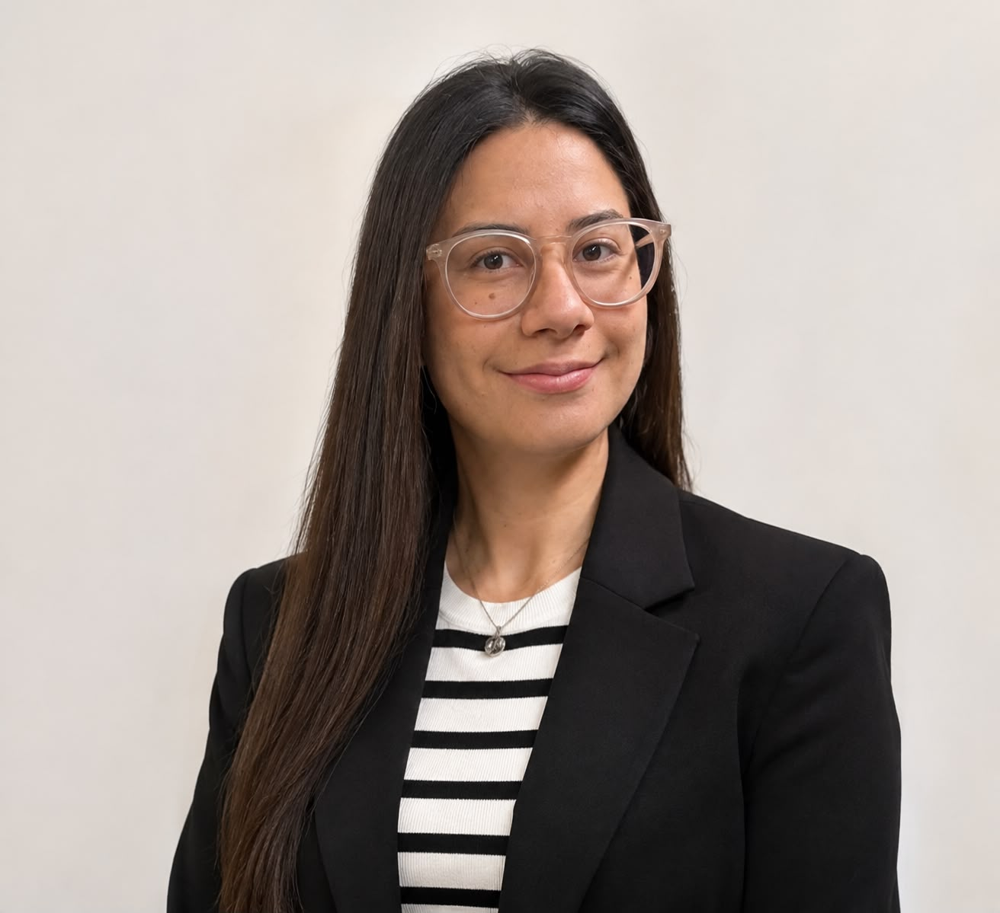

  <button class="button is-link is-outlined is-rounded" onclick="window.print()">
    📄 Descargar CV en PDF
  </button>

## Contacto

* **Ubicación:** Tenerife, España
* **Email:** [analylilie17@gmail.com](mailto:analylilie17@gmail.com)
* **LinkedIn:** [Analy Urdaneta](https://linkedin.com)
* **GitHub:** [AnalyUrdaneta](https://github.com)

## Idiomas

* **Español:** Nativo
* **Inglés:** B2 (Cambridge Linguaskill)

## Stack Técnico

* **Arquitectura & Integración:** Microservicios, APIs RESTful, OData, HL7, XML, Sistemas Distribuidos.
* **Backend & Lenguajes:** Node.js, TypeScript, JavaScript, Python, Java, ABAP.
* **Frontend & Mobile:** React, Next.js, Tailwind CSS, shadcn/ui, Android / iOS (funcional).
* **SAP & Enterprise:** SAP BTP, Integration Suite, CAP, S/4HANA, ECC, IS-H, SAP Joule.
* **Datos & ORM:** PostgreSQL, MySQL, SQL Server, SQLite, Prisma, Supabase.
* **Cloud & DevOps:** Cloud Foundry, XSUAA, Cloud Logging, Git, Control-M, IA aplicada al desarrollo.

# Analy Urdaneta
**Software Engineer | Full-Stack Development**  
*System Integration | Cloud Solutions, APIs & AI-Driven Development*

---

## Perfil Profesional

Ingeniera Informática y Desarrolladora de Software orientada al diseño de arquitecturas escalables, desarrollo de microservicios, aplicaciones full-stack e integración de sistemas complejos. Experiencia conectando ecosistemas heterogéneos mediante APIs, mensajería estándar (HL7) y soluciones cloud, combinando tecnologías open-source con entornos empresariales como SAP BTP, Integration Suite y CAP.

Participo en proyectos clave de modernización tecnológica y transición hacia SAP S/4HANA, aportando una visión integral que une el desarrollo técnico con la gestión de proyectos. En constante evolución hacia prácticas DevOps e Inteligencia Artificial aplicada al ciclo de vida del software.

## Experiencia Profesional

### Software Developer · Hospiten
**Santa Cruz de Tenerife, España | Julio 2024 – Actualidad**

* **Arquitectura e Integración Sanitaria:** Diseño de APIs, microservicios e integraciones bajo estándar **HL7**, conectando sistemas hospitalarios con software médico, portales del paciente y apps nativas (Android/iOS).
* **Despliegues de Alto Impacto:** Ejecución exitosa de la integración de sistemas para pantallas informativas y directorios digitales en la apertura de un nuevo hospital en tiempo real.
* **Desarrollo Full-Stack & Cloud:** Servicios backend y aplicaciones combinando **Node.js, Python y JavaScript** con **SAP BTP, CAP y ABAP** en áreas de facturación y finanzas.
* **Transformación Digital (S/4HANA):** Participación activa en la migración estratégica de **SAP ECC / IS-H hacia SAP S/4HANA**.

### Full-Stack Software Developer · Edushakers vzw (Campus Corso)
**Lovaina, Bélgica | Marzo 2024 – Mayo 2024 · Programa Erasmus+**

* **Plataforma Web End-to-End:** Desarrollo desde cero de una aplicación de gestión de coworking (solicitudes, planificación y reservas) con **TypeScript, Next.js, Prisma, Supabase y shadcn/ui**.
* **Trabajo Ágil en Equipo:** Colaboración en equipo de 4 desarrolladores en arquitectura de datos, lógica de negocio e interfaz.

### Especialista de Automatización / First Level Operations · Ericsson C.A.
**Maracay, Venezuela | Enero 2016 – Junio 2016 · Proyecto Midrange Telefónica**  
*(Finalización por traslado internacional · Carta de recomendación disponible)*

* **Automatización y Continuidad:** Gestión de procesos batch críticos con **Control-M** para operaciones bancarias (OLB Banking) y recargas electrónicas, junto a monitorización con **HP OpenView**.

## Formación Académica

**Máster Universitario en Ingeniería de Software y Sistemas Informáticos**  
*Especialización en IA para Desarrollo de Software y DevOps* · UNIR · 2026 – 2028 (En curso)

**Técnico Superior en Desarrollo de Aplicaciones Multiplataforma (DAM)**  
CIFP César Manrique · Tenerife, España · 2020 – 2024

**Ingeniería Informática**  
Universidad Politécnica Territorial de Aragua “Federico Brito Figueroa” · Venezuela · 2010 – 2015

## Certificaciones y Eventos

* **SAP Joule Studio Agent Lab** — Madrid (2026)
* **Technology Skills: SAP Integration Suite Adoption Lab** — SAP (2025)
* **Learning the Basics of ABAP Programming on SAP BTP** — SAP (2024)
* **Eventos:** SAP Connect Days Madrid (2026) · SAP BTP Integration Suite Summit, Barcelona (2025)

